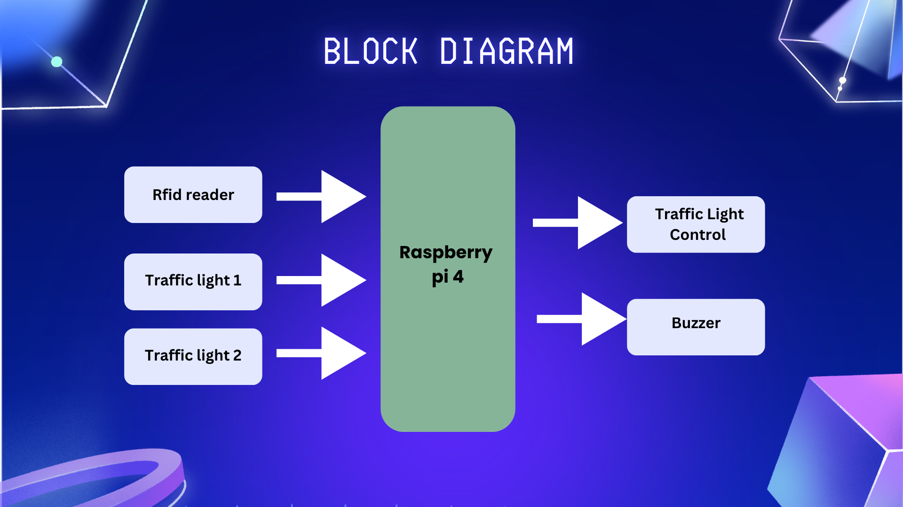
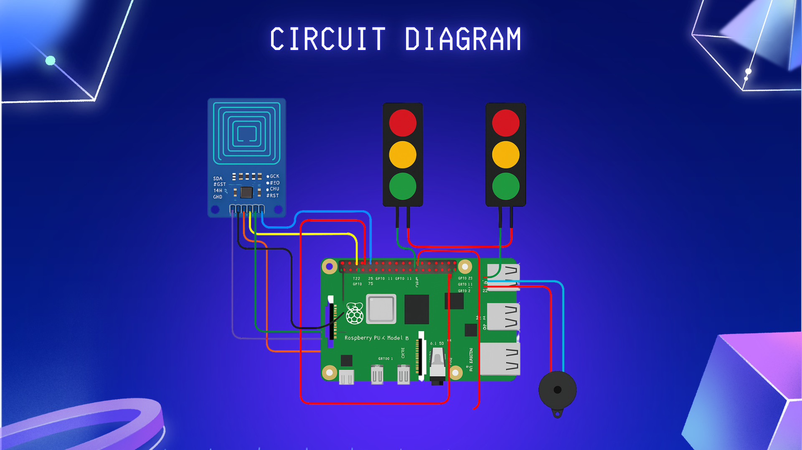

# LIFELANE — Smart Traffic Light System for Emergency Vehicles

<p align="center">
  <strong>Embedded Systems | RFID | Raspberry Pi 4 | Traffic Signal Automation</strong>
</p>

An embedded systems project exploring RFID-based emergency vehicle identification and priority-based traffic signal control using Raspberry Pi 4.

---

## Overview

Traffic congestion can delay emergency vehicles such as ambulances and fire engines, potentially affecting emergency response times.

LIFELANE is designed to demonstrate how RFID identification and a Raspberry Pi can be used to prioritize authorized emergency vehicles in a traffic signal prototype.

An RFID reader identifies a registered tag, and the Raspberry Pi processes the identification event to control two traffic signal units and a buzzer according to programmed logic.

**Project status:** Reference implementation and hardware integration documentation are being developed. The original working source code and test results are not currently available.

## Objectives

- Demonstrate RFID-based emergency vehicle identification.
- Interface an RFID reader with Raspberry Pi 4.
- Control two traffic signal units using GPIO.
- Provide audible indication through a buzzer.
- Develop a priority-based signal control algorithm.
- Explore embedded automation for emergency vehicle management.

## System Block Diagram



The proposed system contains:

- **RFID reader:** Reads the identification tag presented by a vehicle.
- **Raspberry Pi 4:** Processes tag information and executes the control logic.
- **Traffic Light 1 and Traffic Light 2:** Represent two traffic directions.
- **Buzzer:** Provides an audible alert during the emergency-priority event.

## Circuit Diagram



The circuit diagram illustrates the Raspberry Pi, RFID reader, two traffic signal modules, and buzzer.

GPIO pin assignments, voltage requirements, and the final wiring must be verified against the actual hardware before connecting the circuit.

## Hardware Components

| Component | Purpose |
|---|---|
| Raspberry Pi 4 Model B | Main controller |
| RFID reader, such as MFRC522 | Reads registered RFID tags |
| RFID tags/cards | Identify authorized emergency vehicles |
| Traffic signal LEDs | Represent red, yellow, and green signals |
| Buzzer | Provides audible alerts |
| Jumper wires | Connect hardware components |
| Suitable power supply | Powers the Raspberry Pi and peripherals |

The MFRC522 is a suggested reader for the reference implementation. Confirm the actual reader model before using the supplied code.

## Software and Technologies

- Python
- Raspberry Pi OS
- GPIO control
- SPI communication for a compatible MFRC522 reader
- RFID tag identification

## Working Principle

1. Initialize the Raspberry Pi GPIO pins and RFID reader.
2. Start the normal traffic signal sequence.
3. Read RFID tags presented to the reader.
4. Compare the detected tag ID against a configured list of authorized IDs.
5. If an authorized tag is detected, initiate the emergency-priority sequence.
6. Set the relevant signal states according to the programmed logic and activate the buzzer.
7. Return to normal operation after the priority sequence finishes.

The exact lane assignment, signal timing, and emergency-clearance logic must be configured for the actual prototype.

## Reference Implementation

A starter Python program can be maintained in the `src/` directory.

The reference implementation is intended for learning and bench testing. It has not been validated against the illustrated circuit or real traffic conditions.

See [`src/lifelane.py`](src/lifelane.py) for the code.

## Repository Structure

```text
LIFELANE/
├── README.md
├── src/
│   └── lifelane.py
├── images/
│   ├── block-diagram.png
│   └── circuit-diagram.png
└── docs/
    └── wiring.md
```

## Potential Applications

- Embedded systems laboratory demonstrations.
- RFID-based access and identification projects.
- Traffic signal automation prototypes.
- Smart transportation research and experimentation.
- Learning Raspberry Pi GPIO and SPI communication.

## Limitations

- The current documentation is based on the supplied diagrams.
- The original working source code and measured test results are unavailable.
- RFID detection alone does not verify that a vehicle is an actual emergency vehicle.
- The prototype does not implement certified road traffic control or safety interlocks.
- Real-world deployment would require reliable vehicle authentication, fail-safe signal sequencing, testing, and regulatory approval.

## Future Improvements

- Add authenticated vehicle registration.
- Implement configurable emergency-priority timing.
- Add event logging and system diagnostics.
- Handle RFID reader failures and invalid tags.
- Test signal transitions and recovery behavior.
- Explore integration with a traffic monitoring dashboard.

## Author

**Atharva Jadhav**

Electronics and Telecommunication Engineering

- GitHub: [atharva-446](https://github.com/atharva-446)
- Portfolio: [atharvajadhav.co.in](https://atharvajadhav.co.in)

---

*LIFELANE is an educational prototype concept. It is not intended to control public-road traffic or replace certified traffic signal systems.*
